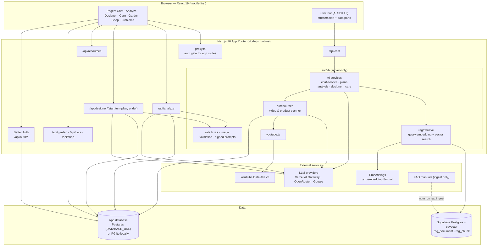
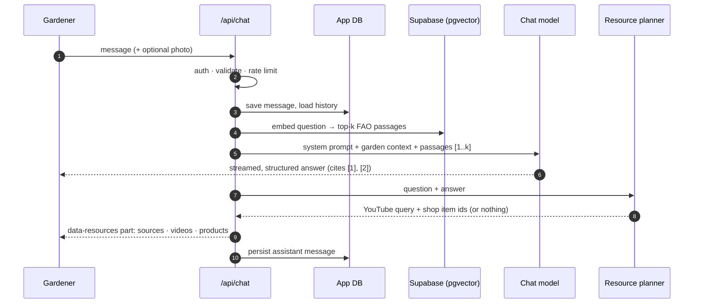
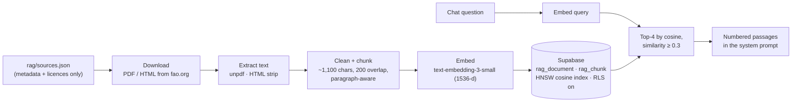

<div align="center">


# ChhadKrishi · ছাদকৃষি

**An AI companion for rooftop and balcony gardeners in Bangladesh.**

Ask questions in Bangla or English, diagnose a sick plant from a photo, design a garden on a photo of your own roof, and keep a care routine — in one mobile-first app.


</div>

---

## Contents

- [Features](#features)
- [Architecture](#architecture)
- [How the AI chat answers](#how-the-ai-chat-answers)
- [Tech stack](#tech-stack)
- [Getting started](#getting-started)
- [Environment variables](#environment-variables)
- [RAG reference library](#rag-reference-library)
- [Project structure](#project-structure)
- [Security and privacy](#security-and-privacy)
- [Testing without API keys](#testing-without-api-keys)
- [Deployment](#deployment)
- [Credits and licences](#credits-and-licences)

## Features

| | Feature | What it does |
|---|---|---|
| 💬 | **AI chat (main workspace)** | Gemini-style chat, Bangla and English, text or plant photos. Answers follow *analysis → likely problem → causes → step-by-step fix → prevention*, cite the FAO reference manuals they used, and end with relevant **YouTube videos** and **ChhadKrishi Shop** items. Conversations are saved; unsent drafts survive navigation. |
| 🔍 | **Photo analysis** | Camera or gallery upload → plant identification, health status, likely issues with signs, organic-first treatment steps, prevention, urgency and confidence — plus helpful videos and products. |
| 🪴 | **AI Garden Designer** | Upload a rooftop/balcony/terrace photo; a conversational consultation collects space, sunlight, plants, budget, style, pots and maintenance; the AI returns a layout, plant list, budget breakdown and build steps, and renders the design **onto your own photo** (before/after slider). |
| 📅 | **Care routine** | AI-suggested watering, feeding and pruning schedules for your saved plants, with a daily task list. |
| 📚 | **Common problems library** | Eight illustrated guides (yellow leaves, overwatering, drainage, pests, low light, rooftop heat, small spaces, root-bound pots). Public — no sign-in needed. |
| 🌱 | **My garden, shop and orders** | Track your plants and garden setup; order seeds, pots and fertiliser. |

**Experience:** mobile-first and touch-friendly; a sidebar that minimises to icons in the chat; a floating chat button on every other page; Bangla/English toggle; reduced-motion support.

## Architecture



**Key design decisions**

- **Server-only AI.** Every model, embedding and YouTube call happens in route handlers; keys never reach the browser. The client only sees stable error codes (`AI_RATE_LIMITED`, `AI_UNAVAILABLE`, …) that the UI translates.
- **Provider-agnostic models.** `src/lib/ai/config.ts` picks the first configured provider (AI Gateway → OpenRouter → Google) and supports per-task overrides and OpenRouter fallback chains.
- **Two databases, two jobs.** The app database (users, chats, gardens, shop) is plain Postgres through Kysely — PGlite (Postgres in WASM) locally, any Postgres in production. The reference library lives in **Supabase with pgvector**, so the vector workload is isolated and optional.
- **Graceful degradation.** No RAG configured → the chat answers without citations. No YouTube key → a "Search on YouTube" card. A slow model in the designer → the standard question bank keeps the consultation going.

## How the AI chat answers



The answer always streams first; videos, products and sources arrive afterwards as one `data-resources` message part, so they are rendered **below** the answer and persisted with it. Product names and prices come from the database, never from the model, and only books the answer actually cited are listed.

## Tech stack

| Layer | Choice |
|---|---|
| Framework | Next.js 16 (App Router, Cache Components, partial prerendering, React Compiler) |
| UI | React 19, Tailwind CSS 4, Motion, lucide-react |
| AI | Vercel AI SDK 7 (`streamText`, `generateText` + `Output.object`, `generateImage`), OpenRouter / AI Gateway / Google providers |
| Auth | Better Auth (email + password, secure cookies, origin checks) |
| Data | Kysely · Postgres / PGlite (app) · Supabase Postgres + pgvector (RAG) |
| Validation | Zod 4 on every request body and every structured model output |

## Getting started

**Requirements:** Node.js 22+, npm.

```bash
git clone https://github.com/tanviranik12/ChhadKrishi.git
cd ChhadKrishi
npm install
cp .env.example .env.local      # then fill in the values (see below)
npm run dev                     # http://localhost:3000
```

Locally the app database is created automatically in `./data` (PGlite) — no database server needed. To enable the reference library, add `SUPABASE_DB_URL` and run:

```bash
npm run rag:ingest -- --dry-run   # download + chunk only, prints statistics
npm run rag:ingest                # embed and store in Supabase
```

Other scripts: `npm run build`, `npm run start`, `npm run lint`.

## Environment variables

All variables are server-side. See [`.env.example`](.env.example) for the annotated template.

| Variable | Required | Purpose |
|---|---|---|
| `BETTER_AUTH_SECRET` | ✅ | Session signing secret (also signs designer render prompts). |
| `BETTER_AUTH_URL` | ✅ | Public origin, e.g. `http://localhost:3000`. |
| `DATABASE_URL` | prod | Postgres for app data. Unset locally → PGlite in `./data`. |
| `AI_GATEWAY_API_KEY` / `OPENROUTER_API_KEY` / `GOOGLE_GENERATIVE_AI_API_KEY` | one | AI provider; the first one set wins. |
| `CHHADKRISHI_CHAT_MODEL`, `CHHADKRISHI_VISION_MODEL` | – | Model overrides (comma-separated fallbacks on OpenRouter). |
| `CHHADKRISHI_IMAGE_MODEL`, `CHHADKRISHI_IMAGE_PROVIDER` | – | Garden-design image model / force its provider. |
| `YOUTUBE_API_KEY` | – | YouTube Data API v3 for video cards with thumbnails. |
| `SUPABASE_DB_URL` | – | Supabase Postgres (pooler) for the RAG library. |
| `CHHADKRISHI_EMBEDDING_MODEL` | – | Embedding model (1536 dimensions; default `openai/text-embedding-3-small`). |

> **OpenRouter note:** free models are limited to 50 requests/day on accounts without credit (1,000/day after adding at least $10). Image generation and embeddings are paid models and need a credit balance.

## RAG reference library



- **Sources:** two FAO manuals — *A Garden for Everyone* (2005) and *Diversifying Rural Incomes Through Home Gardens* (2004), about 220 passages. The repository stores only their metadata; the ingest script downloads the text from FAO at run time.
- **Idempotent:** re-running replaces each document's passages in a single transaction.
- **Safe by default:** row-level security is enabled on both tables with no policies, so Supabase's public REST API cannot read or write them — only the server's direct database connection can.
- **Cross-lingual:** Bangla questions retrieve English passages through the multilingual embedding space; the model answers in the gardener's language and adapts field-garden advice to rooftop containers.
- **Add a book:** append an entry with `title`, `publisher`, `year`, `url`, `license` and `parts` to `rag/sources.json`, then run `npm run rag:ingest`. Only add texts whose licence allows it.

## Project structure

```
src/
├─ app/
│  ├─ page.tsx                  # chat-first landing (visitor sections streamed only for visitors)
│  ├─ (app)/                    # signed-in area: layout with sidebar + floating chat button
│  │  ├─ chat/  analyze/  designer/  care/  garden/  dashboard/  problems/  shop/
│  └─ api/                      # route handlers: chat, analyze, designer/*, resources, care, garden, shop, auth
├─ components/
│  ├─ ai/                       # feature cards, floating chat button
│  ├─ chat/                     # markdown renderer, resource cards (sources · videos · products)
│  ├─ designer/  problems/  landing/  auth/  app/
│  └─ app-header.tsx            # sidebar (auto-minimises in chat) + mobile drawer
├─ lib/
│  ├─ ai/                       # provider config, prompts, chat/analysis/care services, resources, errors, rate limits
│  ├─ rag/retrieve.ts           # query embedding + pgvector search + prompt block
│  ├─ designer/                 # consultation, plan and render services, schemas, question bank
│  ├─ chat/  garden/  care/  shop/  auth/  i18n/
│  ├─ youtube.ts  db.ts  sidebar.ts  chat-draft.ts
│  └─ problems/data.ts          # problems library content (bilingual)
├─ proxy.ts                     # protects signed-in routes
rag/sources.json                # reference books (metadata + licences)
scripts/ingest-books.mjs        # RAG ingest pipeline
public/problems/                # problem photos (Wikimedia Commons, credited in-app)
```

## Security and privacy

- Authentication on every app route (`proxy.ts`) and every API handler; conversations and gardens are scoped to their owner (another user's id behaves like "not found").
- Request bodies validated with Zod; uploaded images checked by magic bytes and size before any AI call; photos for analysis are processed in memory and not stored.
- Per-user rate limits on every AI endpoint; the costliest (image generation) is the strictest.
- Designer render prompts are HMAC-signed server-side, so the client cannot inject its own image prompt.
- Retrieved book passages are framed as reference material, not instructions; model-chosen products are matched against the database.
- Secrets live only in environment variables (`.env*` is git-ignored).

## Testing without API keys

Set `CHHADKRISHI_AI_FIXTURE=1` in development to use a clearly labelled **test model**: chat streaming, photo analysis, the full designer flow and the resource cards all work offline. Include `#fail` in a message to simulate a provider outage. Fixture mode is ignored in production builds.

## Deployment

Any Node.js host works; on Vercel:

1. Import the repository and set the environment variables (`DATABASE_URL` is required in production — e.g. a Supabase or Neon Postgres).
2. Set `BETTER_AUTH_URL` to the production origin.
3. Run `npm run rag:ingest` once (locally, pointing at the production `SUPABASE_DB_URL`) to load the reference library.

## Credits and licences

- **FAO manuals** used by the reference library: © FAO. Reproduction and dissemination for educational or other non-commercial purposes is authorised provided the source is fully acknowledged; commercial reproduction requires FAO's written permission. *A Garden for Everyone* (FAO, 2005) · *Diversifying Rural Incomes Through Home Gardens* (FAO, 2004).
- **Problem photos:** Wikimedia Commons contributors, credited on each problem page.
- **Videos** are linked, not hosted; they belong to their creators on YouTube.
